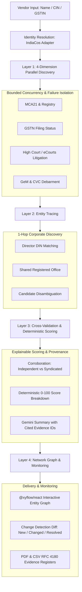

# TinyTrace

> **Evidence-Backed B2B Vendor Due Diligence for Indian Procurement & Compliance**
> 
> *"We don't just find risk signals. We trace who is behind them, prove every claim across independent sources, and clearly separate verified evidence from findings that need human review."*

[](#)
[](#)
[](#)

---

## Table of Contents
1. [Product Overview](#product-overview)
2. [The 4-Layer Architecture](#the-4-layer-architecture)
3. [6.5-Hour Hackathon MVP Alignment](#65-hour-hackathon-mvp-alignment)
5. [Professional Workflows & Exports](#professional-workflows--exports)
6. [Security & Isolation](#security--isolation)
7. [Integrations & Environment Secrets](#integrations--environment-secrets)
8. [Storage Architecture](#storage-architecture)
9. [Local Development & Testing](#local-development--testing)
10. [Cloud Run Deployment Guide](#cloud-run-deployment-guide)

---

## Product Overview

Indian procurement teams face massive blindspots when evaluating suppliers: shell companies, shared directors behind disqualified entities, undisclosed litigation, and sudden debarment on government procurement portals like GeM.

**TinyTrace** solves this through a zero-hallucination, evidence-backed diligence engine:
- **Never fabricates claims**: LLMs are restricted from independently declaring vendors fraudulent. Risk scores are deterministic (0–100).
- **Independent cross-validation**: Syndicated and mirrored press releases never count as multiple independent sources.
- **Explainable scoring**: If upstream data coverage is inadequate, TinyTrace displays `INSUFFICIENT_COVERAGE` rather than a reassuring low score. Absence of data never reduces risk.
- **Zero guilt by association**: Related corporate entities discovered via director DIN or shared addresses are leads for review, not proof of wrongdoing.

---

## The 4-Layer Architecture



### Layer 1: Multi-Dimension Discovery & Failure Isolation
- Orchestrates parallel checks across four dimensions: **Company Registry / GST**, **Court Litigation**, **Debarment / Blacklist (GeM, CVC)**, and **Negative Regulatory News**.
- Bounded concurrency pool (max 3 concurrent jobs), a configurable 120-second overall deadline, and configurable 45-second per-agent deadlines prevent cascading failures. Each agent gets at most two attempts with bounded backoff; cancellation stops active requests and preserves completed task results.
- If one portal times out or encounters upstream 5xx errors, other dimensions complete unaffected and the gap is transparently recorded.

### Layer 2: Evidence-Backed Entity Tracing
- Traverses 1-hop corporate relationships using confirmed identifiers (8-digit Director DINs, registered office addresses, linked CINs).
- **Zero-Name Conflation**: Common Indian director names without confirmed DINs are tagged `same_name_candidate` and are **never** automatically merged.
- Graph edges specify exact evidentiary basis: `LINKED_REGISTRY_ID`, `SHARED_DIRECTOR_DIN`, `SHARED_REGISTERED_ADDRESS`, or `UNVERIFIED_CANDIDATE`.

### Layer 3: Cross-Validation & Deterministic Risk Scoring
- Strict corroboration rules:
  - `multiple_independent_sources`: Requires at least 2 genuinely independent publisher domains with matching corporate identifiers.
  - Routine single-source risk findings receive second-layer AI web verification with Google Search grounding, exact entity identifiers, and retained citations. Critical findings, identity uncertainty, conflicts, and claims the AI cannot verify require human review.
  - Low-severity inconclusive candidates remain unverified leads and are not presented as adverse findings or human review tasks. AI verification is labelled separately from deterministic multi-source corroboration.
  - `conflicting_sources`: Surfaces opposing claims (e.g. pending litigation vs dismissed on appeal).
- **Deterministic 0–100 Risk Score**:
  - Severity points (0–40)
  - Confidence points (0–30)
  - Recency points (0–15)
  - Verification coverage uncertainty points (0-15) when required checks are incomplete
  - Identity matching associates evidence with the correct entity and never adds risk points.
- Summaries generated by Gemini strictly reference citation IDs (`[evi_...]`). If Gemini is unavailable, deterministic rule summaries take over.

### Layer 4: Interactive Graph, Monitoring & Workflows
- **Interactive Network Graph**: Rendered via `@xyflow/react` with accessible table fallback. Red/amber colors indicate verified risk; unverified candidate links remain neutral slate gray.
- **Monitoring & Diff Engine**: Reports can be re-run manually and compared with a historical baseline to identify new, changed, and not-observed signals. Automated monitoring can schedule repeat live checks for completed reports.
- **Audit History**: Vendor profile tracks longitudinal posture and trend (`IMPROVING`, `DETERIORATING`, `STABLE`).

### Automated Company Monitoring
- Start a monitor from a completed live investigation and choose a **daily, weekly, or monthly** check frequency. Monitors can be paused, resumed, or removed.
- The TinyTrace server polls for due schedules every 60 seconds, runs a fresh live investigation, and compares each completed result with the prior baseline. The baseline advances only after a completed run.
- New or changed findings appear in the persistent notification inbox. A finding missing from a later search is **not** treated as resolved or cleared; review the comparison and its source coverage.
- Scheduled checks require the Supabase workspace tables and a continuously running TinyTrace server. The host must keep one instance running for unattended checks; each run uses configured provider services and may consume API credits. See [Supabase Storage and Account Setup](#supabase-storage-and-account-setup) for deployment details.


## Professional Workflows & Exports

### Multi-Attribute Search & Filter
Compliance officers can filter past investigations across:
- Vendor name (case-insensitive substring)
- Identifier (CIN, GSTIN, PAN)
- Status (`COMPLETED`, `PARTIAL_FAILURE`, `IN_PROGRESS`, `FAILED`)
- Review Priority (`ELEVATED_REVIEW_PRIORITY`, `REVIEW_RECOMMENDED`, `INSUFFICIENT_COVERAGE`, etc.)
- Risk Dimension (`company_registry`, `court_litigation`, `blacklist_debarment`, `adverse_media`)
- Date ranges with pagination (up to 50 items/page)

### Executive PDF Report (`jspdf`)
- Formatted compliance report with executive risk index, factor contributions, dimension coverage cards, and formal legal disclaimer.
- Includes report ID, audit timestamps, and data limitations notice.
- Rejects empty exports to prevent unpopulated reports from being circulated.

### CSV Evidence Register (RFC 4180 Compliant)
- Structured register with one row per evidence signal:
  `Vendor`, `Dimension`, `Title`, `Risk Level`, `Severity (1-5)`, `Verification Status`, `Source URL`, `Source Domain`, `Snippet`, `Captured Date`, `Identity Match`, `Review Action`, `Report ID`.
- Sanitized against CSV formula injection (`=`, `+`, `-`, `@`).

---

## Security & Isolation

- **Public Website Research**: Live web research can target any public company website. Local/private addresses, IP-literal hosts, embedded credentials, and unsupported protocols are blocked.
- **Payload & Rate Limiting**: Strict 50KB request payload ceiling and client IP rate limiting (30 requests/minute) protect upstream quotas.
- **Prompt Injection Defense**: Vendor-supplied names and notes are stripped of jailbreak delimiters (`ignore previous instructions`, `system prompt:`) before reaching Gemini.
- **Audit Ledger**: In-memory security audit ledger logs high-risk actions, authentication checks, and export activities with timestamp and IP provenance.

---

## Integrations & Environment Secrets

TinyTrace keeps all credentials strictly server-side. **No API keys or auth headers are ever exposed to the client bundle.**

### Environment Variables

| Variable Name | Required | Description |
|---|---|---|
| `GEMINI_API_KEY` | Recommended | Powers deterministic evidence summaries and brief compliance briefs. |
| `TINYFISH_API_KEY` | Required | Required for live web crawling, litigation dockets, and SSE streaming. |
| `INDIACOS_API_KEY` | Optional | Used for MCA21 master data and Director DIN lookups. |
| `TINYTRACE_INVESTIGATION_TIMEOUT_MS` | Optional | Overall live investigation deadline in milliseconds (default and maximum: `120000`). |
| `TINYTRACE_AGENT_TIMEOUT_MS` | Optional | Per-agent deadline in milliseconds (default: `45000`, maximum: `120000`). |
| `TINYTRACE_AGENT_MAX_ATTEMPTS` | Optional | Total attempts per agent, including the first attempt (default and maximum: `2`; minimum: `1`). Authentication failures are never retried. |
| `TINYTRACE_AGENT_RETRY_BACKOFF_MS` | Optional | Base retry backoff in milliseconds (default: `300`, maximum: `2000`). |
| `PORT` | Optional | Application listening port (default: `3000`). |
| `NODE_ENV` | Optional | Set to `production` or `development`. |
| `SUPABASE_URL` | Required for workspace persistence | Project URL from Supabase, used only by the Node server. |
| `SUPABASE_SECRET_KEY` | Required for workspace persistence | Supabase Secret API key (`sb_secret_...`), server only. It bypasses RLS; never put it in frontend variables, source control, or chat. |
| `SUPABASE_WORKSPACE_ID` | Optional | Workspace row key; defaults to `default_ws` for this single shared workspace. |

---

## Supabase Storage and Account Setup

TinyTrace stores the application workspace in `public.tinytrace_workspace_snapshots` and server domain records (vendors, investigations, signals, evidence, relationships, and run comparisons) in `public.tinytrace_domain_records`. Automated schedules and notifications use dedicated Supabase tables. Each Supabase Auth user receives a private workspace through `public.tinytrace_workspace_memberships`. Browser `localStorage` holds the Auth session and can import an older workspace once; it is not the database.

1. In Supabase Dashboard, open **SQL Editor > New query**, paste the full [`supabase/schema.sql`](supabase/schema.sql), and run it. It creates the private membership, snapshot, domain-record, monitor, and notification tables; the script is safe to rerun.
2. Open **Authentication > Providers > Email** and enable email/password sign-up. Under **Authentication > URL Configuration**, set your local site URL to `http://localhost:3000`; add your production URL when deployed. Email confirmation can stay enabled. New users confirm their address and then sign in.
3. In **Project Settings > API Keys**, copy the Project URL, **Publishable key** (`sb_publishable_...`), and **Secret API key** (`sb_secret_...`). Configure these in `.env` locally and in your host's environment settings:

```env
SUPABASE_URL="https://YOUR_PROJECT_REF.supabase.co"
SUPABASE_SECRET_KEY="sb_secret_REPLACE_ME"
SUPABASE_WORKSPACE_ID="default_ws"
VITE_SUPABASE_URL="https://YOUR_PROJECT_REF.supabase.co"
VITE_SUPABASE_PUBLISHABLE_KEY="sb_publishable_REPLACE_ME"
```

4. Restart TinyTrace, open the site, create an account, and confirm your email if prompted. The first account claims the existing `default_ws` data; later accounts receive isolated workspaces. Sign-in is required for application APIs except the basic health check. TinyTrace validates each Supabase Auth token on the server and scopes database access to that account's workspace.

The Supabase Secret API key bypasses RLS and stays on the server. Only the Publishable key is used in browser code. Never prefix the Secret key with `VITE_` or put it in frontend files.
Automated checks are scheduled in Supabase and polled by the TinyTrace server once per minute. Keep one server instance continuously running for unattended checks; for Cloud Run, use minimum and maximum instances of `1` to avoid scale-to-zero pauses and duplicate runners. Each scheduled check performs a live investigation and consumes the configured provider API usage. New and changed findings are written to the persistent notification inbox; missing results are not treated as clearance.

---

## Local Development & Testing

### Prerequisites
- Node.js (v18 or higher recommended; v20+ supported)
- npm (v9+)

### Installation & Setup

```bash
# 1. Extract the full project ZIP (or clone your repository) and enter the project directory
cd tinytrace
npm ci

# 2. Configure environment
cp .env.example .env
# (Edit .env to add API keys locally. Never commit or share this file.)

# 3. Execute the full test suite (15 suites; rerun locally for current results)
npm test

# 4. Run TypeScript lint check
npm run lint

# 5. Start development server (serves frontend and backend concurrently)
npm run dev
```

Visit `http://localhost:3000` in your browser.

---

## Cloud Run Deployment Guide

TinyTrace is packaged as a unified Node.js Express + Vite application that compiles into a single deployable container.

> [!IMPORTANT]
> **Controlled Deployment Protocol**: The current app uses one shared workspace and has no application sign-in. Keep Cloud Run private; do not enable unauthenticated public access. Configure `SUPABASE_URL` and the server-side `SUPABASE_SECRET_KEY` before deployment.

### Build and Test Verification Before Deployment
```bash
# Confirm TypeScript compilation
npm run lint

# Run all 15 test suites
npm test

# Build production bundle into /dist
npm run build
```

The production bundle may report a large-chunk advisory; this does not fail the build. A successful build does not establish that a live provider investigation completed.

### Google Cloud Run Deployment Steps

```bash
# 1. Set Google Cloud project configuration
gcloud config set project YOUR_GCP_PROJECT_ID
gcloud config set run/region us-central1

# 2. Deploy directly using Cloud Build and Cloud Run
gcloud run deploy tinytrace \
  --source . \
  --platform managed \
  --port 3000 \
  --min 1 \
  --max 1 \
  --no-allow-unauthenticated \
  --set-env-vars NODE_ENV=production,SUPABASE_URL=https://YOUR_PROJECT_REF.supabase.co,SUPABASE_WORKSPACE_ID=default_ws \
  --set-secrets SUPABASE_SECRET_KEY=SUPABASE_SECRET_KEY:latest \
  --set-secrets GEMINI_API_KEY=GEMINI_API_KEY:latest \
  --set-secrets TINYFISH_API_KEY=TINYFISH_API_KEY:latest \
  --set-secrets INDIACOS_API_KEY=INDIACOS_API_KEY:latest
```

<div align="center">
  <sub>Built with rigor for Indian Procurement & Compliance Officers.</sub>
</div>
